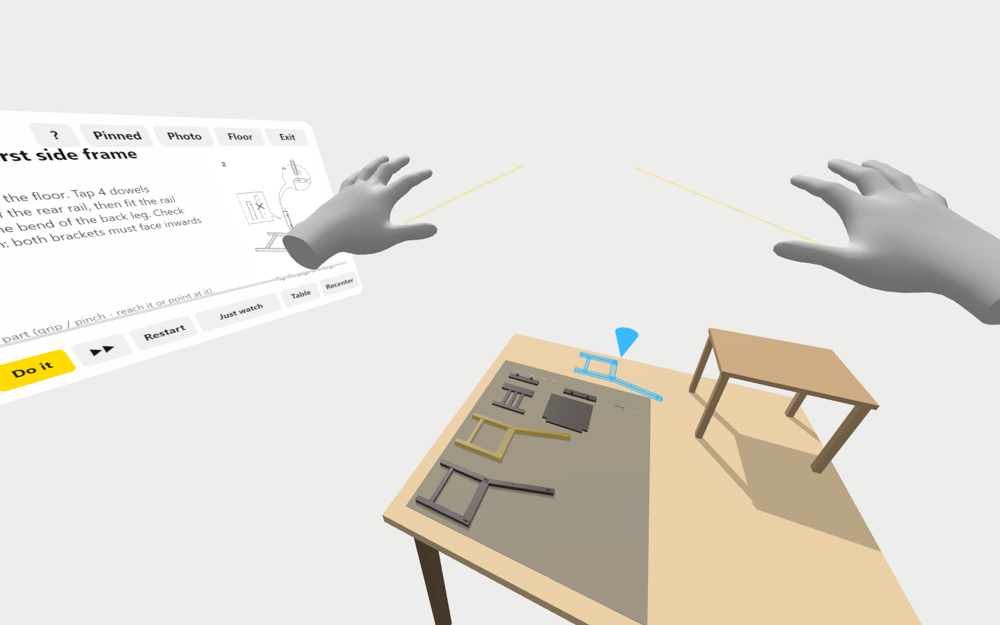
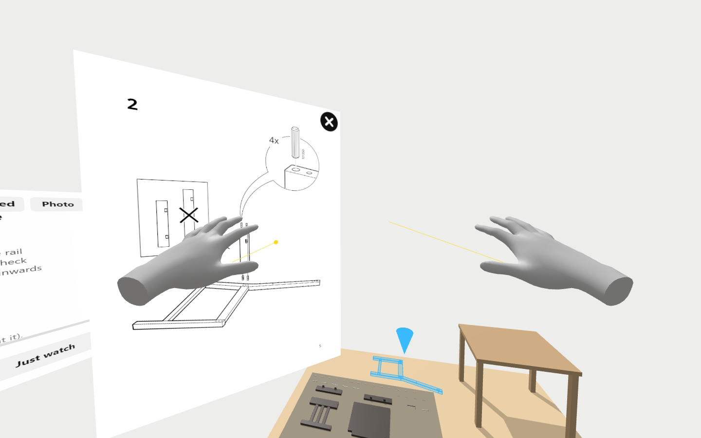
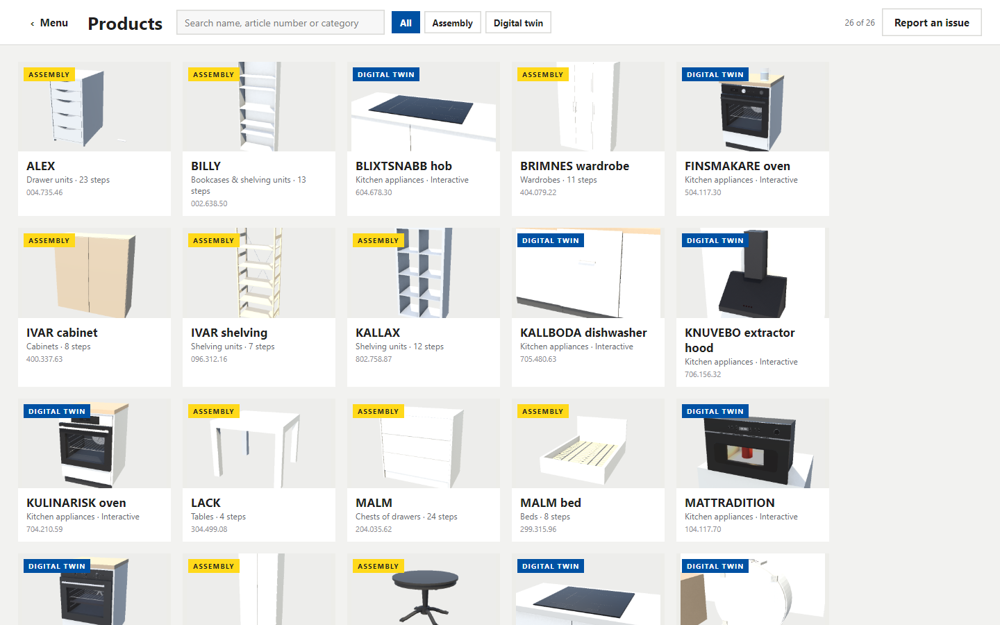
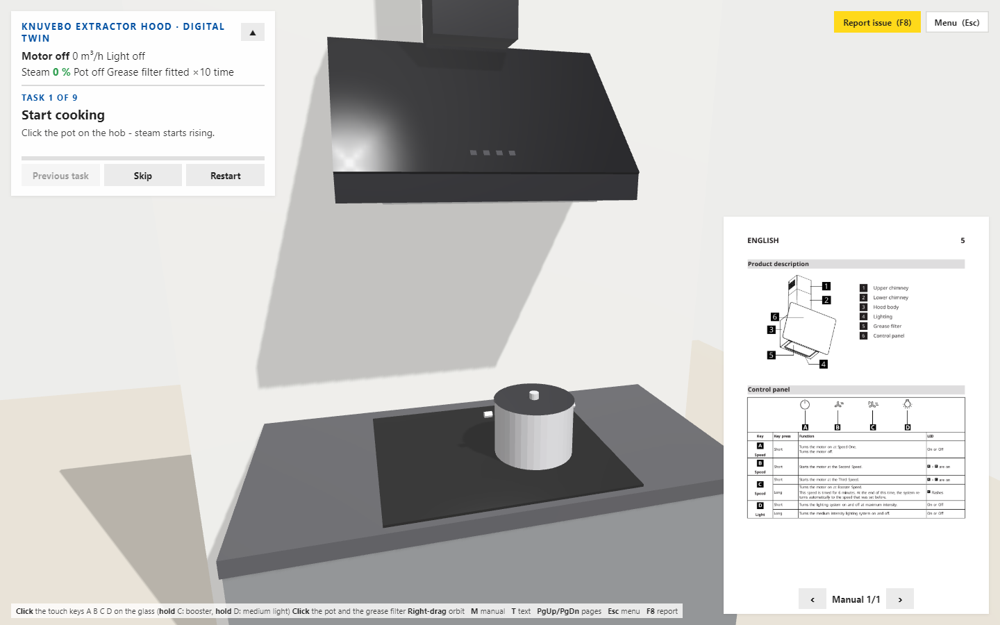

# IKEA Product Lab

**Interactive 3D assembly instructions and digital twins of IKEA products - in the browser, in VR and in AR.**

**Live: https://hybrisen777.github.io/ikea-lab-web/** · nothing to install

Paper manuals show a few frozen moments; this shows the whole motion. Every assembly step is animated from the parts
kit to the finished product, next to the matching page of the IKEA manual - and in VR you build it yourself, with your
hands, on a table in front of you. Appliances are working models: press the keys of a hob, an oven or an air purifier
and they behave like the real one, with guided tasks from their user manuals.

A non-commercial research demo from the Poznań University of Economics and Business (UEP), Department of Information
Technology (KTI), on XR-supported instructions and product use.

## Try it

| Device | How |
|---|---|
| **Meta Quest** (3 / 3S / 2 / Pro) | Open the link in the **Quest Browser**, pick an assembly product, press **Enter VR**. Hands or controllers. |
| **PC + Quest Link** | Chrome or Edge, same steps. The first start over Link can take 2-3 minutes (a Chrome / Meta issue, see below). |
| **Android phone** | Chrome, **Enter AR**: the product stands on your real floor or table. |
| **Desktop / laptop / iPhone** | Any current browser: 3D player with mouse, touch and keyboard. |

## In VR - built for hands

- **Hands first.** Point and pinch to press buttons; pinch a glowing part, bring it to its blue outline - it clicks
  in by itself. No controller needed from start to finish (controllers work too).
- **Seated or standing, no walking needed.** With hands the product comes to a table in front of you, every part
  within reach. Pinch with both hands in empty space and pull apart to make it bigger, move or turn it.
- **Forgiving like real assembly.** Identical parts are interchangeable (any dowel in any hole, a leg in any corner,
  turned any of its symmetric ways); parts fitted into a loose rail move with it; already fitted parts stay put.
- **The manual is always there.** Tap the page on the step panel and it opens as a large, sharp window (re-rendered
  from IKEA's PDFs). Grab the panel or the page and put it where you like - pinned, or following you.
- **Watch or build.** *Just watch* plays the animation; *Build it yourself* waits for you at every move; finished steps
  open the next one by themselves. A help card explains the gestures on the first visit (**?** on the panel).
- **Pause anytime.** Take the headset off and put it back on: it continues where you were.

## What's inside

**Assembly guides (14)** - ALEX drawer unit, BILLY bookcase, BRIMNES wardrobe, IVAR cabinet, IVAR shelving, KALLAX,
LACK side table, MALM bed, MALM chest of 3 drawers, PAX / FORSAND wardrobe, ROSENTORP extendable table, STEFAN chair,
STORKLINTA chest of drawers, TROTTEN desk (crank).

**Digital twins (10)** - SMAKLIG and BLIXTSNABB induction hobs, FINSMAKARE (steam) and KULINARISK (pyrolytic) ovens,
MATTRADITION oven and microwave, KALLBODA and TORSBODA dishwashers, KNUVEBO extractor hood, STARKVIND air purifier.

**Assemble, then use (2)** - STARKVIND table with air purifier and TROTTEN sit/stand desk (electric): build it, then
press *Assembled - now use it*.

| | |
|---|---|
|  |  |

## Desktop controls

| | Assembly guides | Digital twins |
|---|---|---|
| Look around | drag = orbit, wheel / pinch = zoom, middle or Shift-drag = pan | right-drag or drag on empty space = orbit, wheel = zoom |
| Play | Space play / pause, ← → steps, J K L reverse / pause / play, − + speed | click keys and knobs, hold them where the manual says so |
| Help | click a part to identify it, X x-ray, C auto camera, M manual page | wheel over a knob turns it, Shift+click pins a key for two-key presses |
| Menu | Esc - settings, restart, other products | Esc - settings, restart, other products |

Settings (speed, step-by-step or continuous, camera, x-ray) are remembered in your browser.

## How it's made

- **Models** from the IKEA manuals and product pages, one object per physical part; checked against IKEA's published
  measurements (assembly products within about 1 cm; the larger differences are real parts such as handles or wall
  brackets). Holes are drilled for every fastener.
- **Assembly motion** is planned and collision-checked in Unity (every part's path, mesh against mesh), then exported as
  engine-independent data - step timelines, poses, manual pages - that this site plays with
  [three.js](https://threejs.org) 0.169. No build step, no framework.
- **Digital twins** are behaviour models built from the user manuals; each web version is checked against the Unity
  version by a replayed control sequence that must give identical states and displays.
- **VR / AR** is plain [WebXR](https://immersiveweb.dev). Desktop visitors download only a 2 KB detection script; the
  rest loads when you press Enter VR / AR. Tested with Playwright and Meta's IWER emulator, including a walk that
  builds every product start to finish - once with emulated controllers, once with emulated tracked hands (over 1,200
  parts carried and snapped each time).

## Known limitations

- **Quest Link + desktop Chrome:** the first VR start can take 2-3 minutes - Chrome's security sandbox delays the
  connection to Meta's Link runtime (in the Quest Browser there is no such wait).
- Digital twins are desktop / mobile only for now (no VR mode yet).
- iPhone / Safari has no WebXR: the 3D player works, the VR / AR buttons don't appear.

## Found a problem?

Press **F8** (or *Report issue*). The report opens as a pre-filled GitHub issue in this repository, with the product,
step and state already filled in; the screenshot is saved to your downloads - drag it into the issue. A GitHub account
is needed, and issues are public, so please don't include personal data. You can also open an issue directly:
https://github.com/Hybrisen777/ikea-lab-web/issues

This repository holds the built site only (generated - changes here are overwritten by the next build).

## Credits and rights

Research demo by Jeremi Ranosz, UEP / KTI. Not commercial, not affiliated with or endorsed by IKEA.
Product names, manual pages and product photos belong to Inter IKEA Systems B.V. and are used here for research and
demonstration, to help people assemble and use IKEA products. Controller and hand models: WebXR Input Profiles (MIT).
